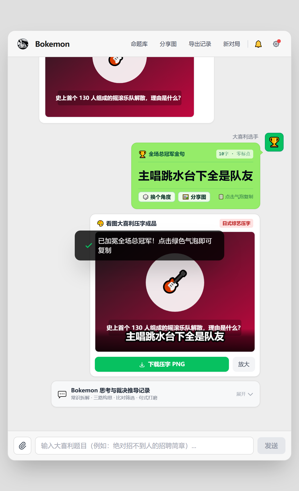
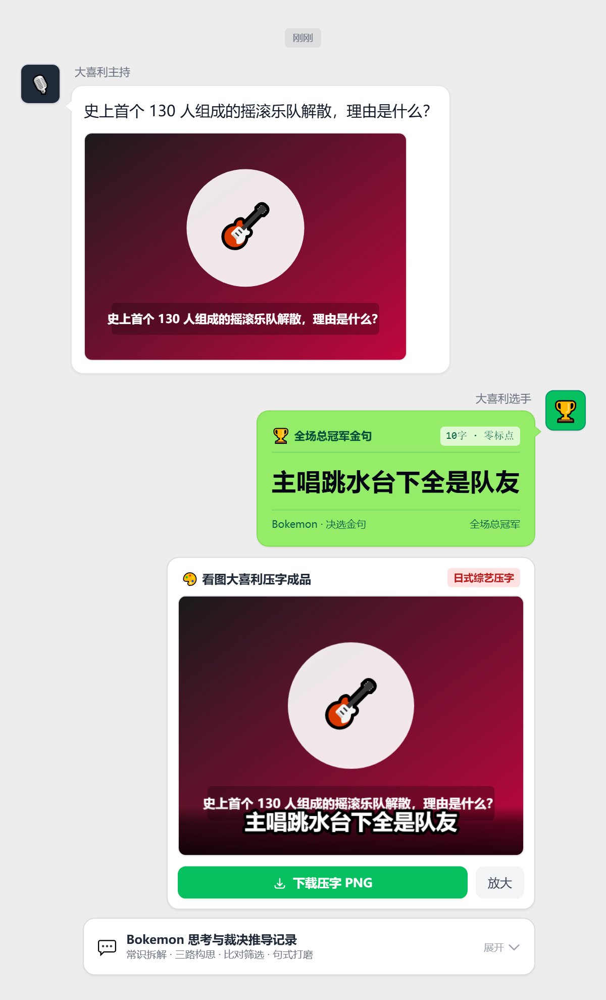

<div align="center">


# Bokemon (ボケモン)
### 日式大喜利智能流水线 · 纯前端微信交互式工作台
**AI-Powered Japanese Oogiri Pipeline · Serverless Web Studio**  
**AI駆動型 日本式大喜利（オオギリ）スタジオ**

[](LICENSE)
[](https://vuejs.org/)
[](https://tailwindcss.com/)
[]()

🌐 **在线体验**：[https://bokemon.joffoo.workers.dev/](https://bokemon.joffoo.workers.dev/)

[简体中文](#-简体中文) • [English](#-english) • [日本語](#-日本語)

<br/>



</div>

---

## 🇨🇳 简体中文

### 💡 核心设计与理念

**Bokemon** 是一款将**日式大喜利（Oogiri）企划流水线**完整落地的纯前端交互式 Web 应用。它模仿微信聊天对话流的自然交互，彻底摆脱传统 AI“文言文复读”、“说明文拆字”和“网络旧梗复读”的平庸套路。

用户可通过自备 API 凭证（BYOK 模式，支持 OpenAI、OpenRouter、DeepSeek、SiliconFlow 等中转接口），在本地浏览器内直连大模型驱动三阶段完整推导：
- **Stage 0 常识地基（土台）**：抓取命题真实物理切片，强力排查现实叹气、廉价网梗等平庸三阱；
- **Stage 1 三轨一次发散**：单次调用同时完成三个方向（生活破绽、职业动作清单与单参数物理极限推演）的候选生成；
- **Stage 2 裁决加冕与句式重铸**：通过公诉人证伪裁决、四关淘汰、三向句式打磨（现场喝止体、量化规矩体、冷空白描体），产出 ≤14 字自然白话总冠军金句。

---

### ✨ 核心特性

- 📱 **微信聊天记录质感 Timeline**：出题白色气泡、加冕微信经典绿色气泡、多角度再次出击与一键金句复制。
- 🖼️ **看图大喜利与日式综艺压字**：自动对图片命题生成经典的红底白字超粗描边综艺压字效果，一键导出 PNG。
- 🔍 **思考过程折叠盒与加冕平反**：可展开查看全流程推导细节，并支持手动切换为备选变体加冕。
- 📸 **原生级分享长图导出**：集成 `modern-screenshot` 原生排版截图引擎，所见即所得，精准还原气泡样式与推导展开状态。
- 🔒 **本地安全存储（BYOK）**：API Key 等凭证仅保存在浏览器客户端（`localStorage` / `sessionStorage`），绝不上传任何第三方。
- ⚡ **开箱即用（Zero-Build）**：无需 Node.js 后端，双击 `index.html` 即可运行。

<br/>

<div align="center">
  
  <p><em>▲ 点击“分享图”一键生成的原生渲染长图卡片</em></p>
</div>

---

### 🚀 快速开始

1. **获取代码**：克隆本仓库（或下载 ZIP 解压）得到项目目录 `Bokeman/`。
2. **启动应用**：
   - 方式一：直接在浏览器双击打开 `index.html`；
   - 方式二：使用本地静态服务器启动：
     ```bash
     npx serve .
     # 或
     python -m http.server 8000
     ```
3. **配置凭证**：点击右上角「⚙️ 设置」，填入您的兼容 API Key 与 Base URL 即可畅玩！
4. **中转站不支持浏览器跨域（CORS）时**：双击 `启动.bat`（需已装 Python 3），会自动打开 `http://127.0.0.1:8787/`，然后照常在设置里填自己的 Base URL、API Key 和模型即可。页面会自动把跨域请求交给本机中转，转发目标就是你填的地址。中转只监听本机、只接受本机页面的请求，Key 只透传、不保存、不打印。
5. **部署（可选）**：纯静态托管即可直接上线；仅当中转站不开放 CORS 时才需要代理层，任选其一：
   - **Cloudflare**：`wrangler deploy`（走 `_worker.js` + `wrangler.toml`）；
   - **Vercel**：`vercel deploy`（走 `api/proxy.js`；函数上限 60s，代理在 58s 主动超时上游返回 502，长思考模型建议直连使用）。

   API Key 始终只存在浏览器本地，代理仅原样透传，不保存、不打印。

---

## 🇺🇸 English

### 💡 Overview & Philosophy

**Bokemon** is a frontend-only interactive web application that implements the complete **Japanese Oogiri (大喜利) Comedy Pipeline**. Designed with an authentic WeChat-style timeline UI, it eliminates generic AI clichés, literal explanations, and tired internet memes.

Users can supply their own LLM API credentials (BYOK mode, supporting OpenAI, OpenRouter, DeepSeek, SiliconFlow, and compatible endpoints) to drive the three-stage comic reasoning pipeline locally:
- **Stage 0 Physical Telemetry**: Extracts grounded facts and explicitly eliminates hackneyed traps (cynical complaints, cheap internet puns).
- **Stage 1 Three-Track Divergence**: Generates candidates across everyday human flaws, professional habits, and single-parameter physical extremes in one combined call.
- **Stage 2 Prosecutor Trial & Recast**: Evaluates candidates against strict comedy gates, trials them under a prosecutor prompt, and recasts them into natural, concise punchlines (≤14 characters).

---

### ✨ Features

- 📱 **WeChat-Inspired Interface**: Smooth timeline with left-aligned host prompts, right-aligned green winning bubbles, re-roll buttons, and click-to-copy convenience.
- 🖼️ **Image Oogiri with Variety Subtitles**: Automatically renders Japanese variety show stroke-outlined bold subtitles on picture prompts.
- 🔍 **Merged Record Details**: Collapsible breakdown showing Stage 0 analysis, the candidate pool, and prosecutor reasoning, with manual variant crowning.
- 📸 **Native DOM Screenshot Sharing**: Powered by modern native SVG rasterization, generating pixel-perfect long cards that match the live viewport.
- 🔒 **Client-Side Privacy (BYOK)**: All keys and session histories are stored strictly in client browser storage (`localStorage` / `sessionStorage`).
- ⚡ **Zero Build & Client-Side BYOK**: Pure HTML5/JavaScript; simply double-click `index.html` to run. An optional tiny CORS relay (Cloudflare / Vercel / local) is included for endpoints that don't allow cross-origin calls.

---

### 🚀 Quick Start

1. **Get the code**: clone this repository (or download the ZIP) to get the project directory `Bokeman/`.
2. **Open the App**:
   - Double-click `index.html` in any modern browser;
   - Or start a static web server:
     ```bash
     python -m http.server 8000
     ```
3. **Configure API**: Click the top-right **Settings (⚙️)** icon, input your OpenAI-compatible API credentials, and start playing!
4. **Deployment (optional)**: any static host works out of the box. A proxy layer is only needed when your endpoint disallows CORS: Cloudflare (`wrangler deploy`, `_worker.js`), Vercel (`vercel deploy`, `api/proxy.js`, 60s function cap — upstream aborts at 58s), or local `python server.py`.

---

## 🇯🇵 日本語

### 💡 コンセプトと概要

**Bokemon（ボケモン）** は、日式「大喜利（オオギリ）」の思考プロセスを完全に自動化した、ブラウザ完結型の対話型 Web スタジオです。WeChat（微信）風のタイムラインUIを採用し、従来のAI特有の「説明口調」「不自然な漢文風表現」「使い古されたネットスラング」を徹底的に排除します。

ユーザー自身のAPIキー（BYOK方式、OpenAI / OpenRouter / DeepSeek / SiliconFlow 等に対応）を使用し、ブラウザ内で完結する3段階のボケ推敲パイプラインを実行します：
- **Stage 0 常識の土台解析**：お題の物理的前提を抽出し、陳腐な愚痴やありがちなオチなどの罠を事前除外。
- **Stage 1 3系統一括発散**：「生活のボロ」「職業的動作」「物理的極限」の3方向の候補を1回の呼び出しで同時生成。
- **Stage 2 公訴人裁決と構文再鋳造**：公訴人プロンプトによる反駁試験と淘汰を経て、14文字以下の切れ味鋭い白話ボケを生成。

---

### ✨ 主な機能

- 📱 **WeChat風タイムライン**：お題の白吹き出し、勝者の緑吹き出し、ワンクリックコピー、別視点での再試行（リロール）。
- 🖼️ **画像お題のバラエティテロップ焼き込み**：写真お題に対して日本のバラエティ番組風の極太縁取りテロップをCanvas自動合成・PNG出力。
- 🔍 **思考プロセスの展開カード**：土台解析・全ボケ候補・裁決ログの全容を確認可能。別候補を手動で優勝に繰り上げる平反機能付き。
- 📸 **ピクセル精度の対戦共有画像生成**：`modern-screenshot` によるブラウザネイティブ描画で、見た目そのままの綺麗な長文対戦カードを書き出し。
- 🔒 **プライバシー第一（BYOK）**：APIキーやチャット履歴はすべてローカル（`localStorage` / `sessionStorage`）にのみ安全保管。
- ⚡ **ビルド不要ですぐ動く**：Node.js不要、`index.html` をブラウザで開くだけで即座に起動。

---

## 🛠️ Tech Stack / 技术栈 / 技術スタック

| Category | Technologies |
| :--- | :--- |
| **Frontend Framework** | [Vue 3 (Composition API / CDN)](https://vuejs.org/) |
| **Styling & UI** | [Tailwind CSS CDN](https://tailwindcss.com/) + Custom Variety Typography |
| **Rendering & Canvas** | HTML5 Canvas API + [modern-screenshot](https://github.com/qq15725/modern-screenshot) |
| **Architecture** | Static SPA, 100% client-side (BYOK) + optional CORS relay (Cloudflare / Vercel / local) |
| **Testing Suite** | Python 3 + Playwright (Headless & Full Browser Acceptance) |

### 🪝 Git Hooks / 提交钩子

钩子放在 `.githooks/`（跟仓库一起走，不是只躺在 `.git/hooks` 里）。**首次检出后启用一次：**

```bash
git config core.hooksPath .githooks
chmod +x .githooks/pre-commit    # 仅 macOS / Linux 需要
```

| Hook | 作用 |
| :--- | :--- |
| `pre-commit` | 拦截超过 **20 KB** 的源码文件，报错里给出按功能拆分的建议；跳过 lockfile、`*.min.*`、构建产物、文件头标了 `@generated` 的生成文件、图片字体 |

文件一大，人和模型都很难一次读完，改动时容易只看到局部。已有的大文件登记在 `.githooks/size-baseline.txt`（如 `index.html`）：**不超过记录值仍可提交，一旦变大同样被拦**。拆分完成后请删掉对应行 —— 基线只降不升。

临时绕过：`git commit --no-verify`。

---

## 📄 License

Distributed under the [MIT License](LICENSE).
